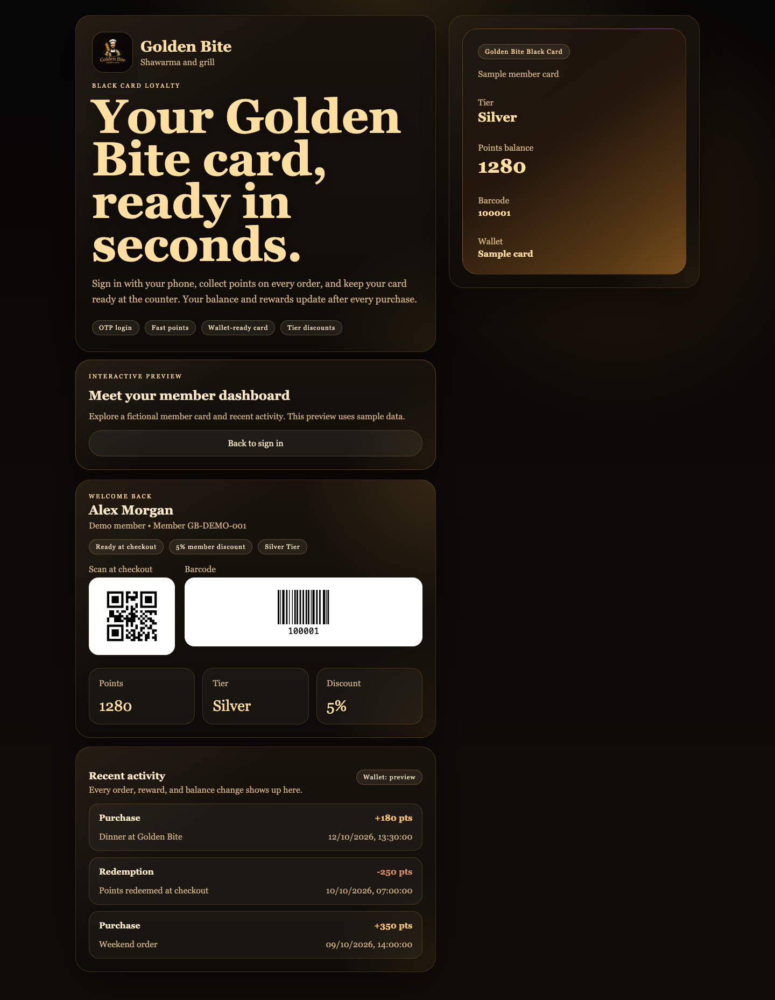

# Golden Bite Loyalty

[](https://github.com/AmyArgotti/golden-bite-loyalty/actions/workflows/ci.yml)

A restaurant loyalty platform with a gold-and-black customer experience, a staff checkout panel, and an admin workspace. Built with **Next.js, React, TypeScript, FastAPI, PostgreSQL, and Redis**.

## Try the customer experience

```bash
git clone https://github.com/AmyArgotti/golden-bite-loyalty.git
cd golden-bite-loyalty/apps/web
npm ci
npm run dev
```

Open **http://localhost:3000** and select **Explore demo** to see a fictional member's points, tier, discount, and transaction history. The preview needs no database, SMS credentials, or backend. Return to sign in to use the API-backed experience.

## Preview



[View the mobile preview](docs/images/customer-mobile.png)

## What it demonstrates

- Customer phone login through one-time codes, profile editing, consent tracking, and loyalty history.
- Staff customer lookup, purchase registration, redemption, and permission-aware point adjustments.
- Admin controls for loyalty rules, staff management, reporting, and audit activity.
- Backend services for loyalty calculations, tiers, rate limiting, wallet lifecycle, and transactional operations.
- Responsive customer UI with keyboard focus states and reduced-motion support.
- Container infrastructure, database migrations, deployment scripts, and operational runbooks.

## Architecture

```text
Customer app :3000 ─┐
Staff panel  :3001 ─┼── FastAPI :8000 ── PostgreSQL
Admin panel  :3002 ─┘        │
                         Redis / Celery
                            │
                       SMS / Apple Wallet
```

| Directory | Purpose |
| --- | --- |
| `apps/web` | Customer membership card and profile |
| `apps/staff-panel` | Checkout and customer operations |
| `apps/admin-panel` | Management and reporting |
| `backend` | API, services, models, migrations, and tests |
| `infrastructure` | Docker, Nginx, backups, and deployment |
| `docs` | Architecture, deployment, and operational guides |

## Run the full stack locally

Prerequisites: Node.js 22+, Python 3.13, and Docker Compose.

From the repository root:

```bash
cp .env.example .env
docker compose -f infrastructure/docker/docker-compose.dev.yml up -d
python3 -m venv .venv
source .venv/bin/activate
pip install -r backend/requirements.txt
(cd backend && PYTHONPATH=. alembic upgrade head)
PYTHONPATH=backend python backend/app/db/seed.py
PYTHONPATH=backend uvicorn app.main:app --reload --app-dir backend
```

Start each frontend in a separate terminal:

```bash
cd apps/web                 # customer: http://localhost:3000
npm ci
npm run dev
```

Repeat in `apps/staff-panel` (port 3001) and `apps/admin-panel` (port 3002). The default API URL is `http://127.0.0.1:8000/api/v1`; override it with `NEXT_PUBLIC_API_BASE_URL` when needed. For hosted frontends, set backend `CORS_ORIGINS` to a JSON array of the exact allowed origins. API documentation is at `http://127.0.0.1:8000/docs`.

The development SMS provider is mocked. A demo OTP appears after requesting a code. Seeded development accounts are `+79990000001` (admin) and `+79990000002` (staff). Never use these defaults in a production deployment.

## Verification

```bash
# From the repository root, with the Python environment active
python -m pytest -q

# In each frontend directory
npm run typecheck
npm run build
```

GitHub Actions runs the backend suite and checks all three frontends on pushes and pull requests. Tests cover loyalty calculations, authentication, tiers, staff actions, rate limiting, and API routes using mocked dependencies; they do not replace a live database/SMS/device acceptance test.

## Scope and current limitations

This is a portfolio implementation with deployment scaffolding, not a claim of a verified production rollout.

- Browser cards encode member identifiers as QR and Code 128; scanner/POS interoperability still requires testing with the target checkout devices.
- Apple Wallet lifecycle routes exist, but usable signed passes require Apple signing certificates and testing on a real device. Unsigned development passes are not installable production passes.
- Real SMS delivery requires provider credentials and staging verification.
- The demo uses fictional read-only data and does not authenticate a user or issue a wallet pass.
- Full-stack database, background worker, payment/POS integration, and production deployment require separate environment testing. No public deployment URL is claimed here.

## Further reading

- [Technical specification](docs/technical-spec.md)
- [Deployment guide](docs/deployment.md)
- [Server setup](docs/server-setup.md)
- [Staging checklist](docs/staging-checklist.md)
- [Production launch checklist](docs/production-launch-checklist.md)
- [Operations runbook](docs/operations-runbook.md)

Environment files, database dumps, backups, and signing keys are excluded from version control.
